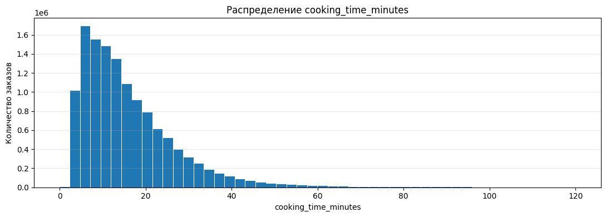
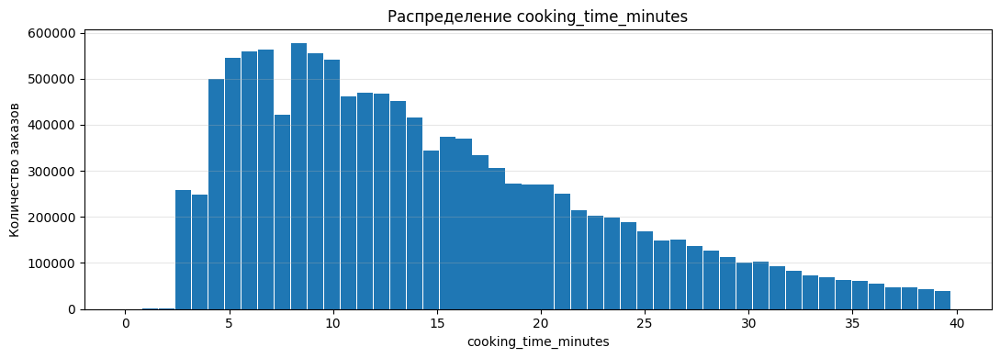
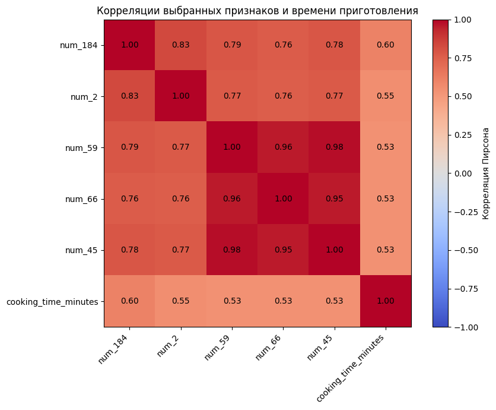

# Протокол лабораторной работы № 1

**Тема:** разведочный анализ больших данных с использованием Apache Spark.

**Датасет:** Cooking Time — время приготовления ресторанных заказов.

## 1. Цель и задачи

Цель работы — исследовать данные о ресторанных заказах средствами PySpark, подготовить их для дальнейшего использования и определить признаки, связанные с временем приготовления.

В ходе работы необходимо:

1. Определить типы признаков.
2. Исследовать пропущенные значения и устранить их.
3. Выявить и обработать выбросы.
4. Рассчитать статистические показатели, включая средние и квартили.
5. Визуализировать распределения наиболее важных признаков.
6. Исследовать корреляции между признаками.

## 2. Исходные данные

Источник: [Cooking Time на Kaggle](https://www.kaggle.com/datasets/pcovkrd84mejm/cooking-time)

Каждая строка соответствует заказу в ресторане сервиса доставки. Признаки отражают характеристики состава заказа и исторические данные о приготовлении по ресторанам, брендам и времени. Индивидуальная расшифровка обезличенных признаков не опубликована.

| Характеристика | Значение |
|---|---|
| Исходный файл | `cooking_time.parquet` |
| Количество строк | 12 799 642 |
| Количество столбцов | 197 |
| Период наблюдений | 15.11.2023 00:00:01 — 03.01.2024 21:56:31 |
| Целевая переменная | `cooking_time_minutes` |
| Единица измерения цели | Минута |

| Название столбца | Расшифровка |
|---|---|
| `num_0` … `num_185` | 186 обезличенных количественных признаков; исходный тип `float` |
| `bin_0` … `bin_2` | Три бинарных признака со значениями 0 и 1, исходно хранящимися как `float` |
| `cat_0` … `cat_5` | Шесть категориальных признаков, представленных целочисленными кодами типа `long` (`bigint`) |
| `timestamp` | Временная метка наблюдения типа `timestamp_ntz`, без часового пояса |
| `cooking_time_minutes` | Фактическая длительность приготовления заказа, тип `float` |

Коды `cat_*` обозначают категории. Их величину и расстояния между кодами нельзя трактовать как количественные характеристики. Точный этап заказа, соответствующий `timestamp`, и исходный часовой пояс не уточнены.

## 3. Среда и порядок запуска

| Файл | Назначение |
|---|---|
| [1_Data_cleansing.ipynb](1_Data_cleansing.ipynb) | Чтение данных, диагностика значений и подготовка исходной таблицы Iceberg |
| [2_Exploratory_analysis.ipynb](2_Exploratory_analysis.ipynb) | Очистка, статистики, графики, корреляции и сохранение обработанной таблицы |
| `images/` | Графики, извлечённые из сохранённых результатов второй части |

На удалённом узле файлы расположены следующим образом:

```text
SOBD/
├── dataset/
│   └── cooking_time.parquet
└── Lab_1/
    ├── 1_Data_cleansing.ipynb
    └── 2_Exploratory_analysis.ipynb
```

Загрузка в HDFS выполняется в терминале из папки `SOBD`. Если терминал открыт в `SOBD/Lab_1`, сначала нужно выполнить `cd ..`.

```bash
hdfs dfs -mkdir -p /user/$USER/datasets
hdfs dfs -copyFromLocal dataset/cooking_time.parquet /user/$USER/datasets/
hdfs dfs -ls /user/$USER/datasets/cooking_time.parquet
```

## 4. Подготовка данных — первая часть

Файл читается из HDFS методом `spark.read.parquet()`. Проверены схема, примеры строк и распределения бинарных значений. Списки `num_cols`, `bin_cols` и `cat_cols` содержат только названия столбцов.

По результатам диагностики:

- все бинарные признаки содержат допустимые значения 0 и 1;
- в 61 числовом столбце обнаружены `NaN`;
- при выполненной полной проверке бесконечности не обнаружены;
- пропусков цели и временной метки нет;
- минимальная длительность равна примерно −2,117 минуты, максимальная — 120 минут;
- обнаружено 25 отрицательных длительностей.

Выявленные `NaN` заменены на `NULL`, чтобы далее учитывать их как пропуски. Типы столбцов сохранены: повторного приведения к уже существующим типам не требуется. Отрицательные длительности на этом этапе оставлены для отдельного рассмотрения во второй части.

Подготовленная таблица сохранена в Iceberg:

```text
spark_catalog.cooking_time_database.sobd_lab1_cooking_time
```

## 5. Разведочный анализ и очистка — вторая часть

### 5.1. Проверка целевой переменной

Из таблицы исключены 25 строк с отрицательной длительностью: время приготовления не может быть отрицательным. Пропусков цели и временной метки не найдено. После этой проверки осталось 12 799 617 строк.

### 5.2. Статистики и выбросы

Вычислены количество наблюдений, минимум, максимум, среднее, стандартное отклонение, Q1, медиана, Q3 и P95.

Q1, медиана и Q3 соответствуют границам 25%, 50% и 75% упорядоченных наблюдений; P95 — границе 95%. В `approxQuantile()` используется допуск `0.001` по рангу — позиции значения в упорядоченном ряду, а не по длительности в минутах.

Для ограничения хвостов распределения принято правило Тьюки:

```text
IQR = Q3 − Q1
Нижняя граница = Q1 − 1,5 × IQR
Верхняя граница = Q3 + 1,5 × IQR
```

IQR — ширина центральных 50% данных. Правило расширяет этот диапазон на полторы его ширины в обе стороны. Коэффициент 1,5 — принятое практическое соглашение; значения за границами считаются потенциальными выбросами. [Описание правила NIST](https://itl.nist.gov/div898/handbook/prc/section1/prc16.htm).

Для длительности нижняя граница ограничена нулём. В выполненном расчёте получен диапазон примерно **0–39,742 минуты**. Исключены **444 633 строки, около 3,47%** от набора после удаления отрицательных длительностей. Это реальное исключение строк из дальнейшего анализа, а не изменение масштаба графика.

| Показатель, минуты | До IQR-фильтрации, без отрицательных длительностей | После IQR-фильтрации |
|---|---:|---:|
| Среднее | 15,775 | 14,551 |
| Стандартное отклонение | 10,672 | 8,430 |
| Минимум | 0,000 | 0,000 |
| Q1 | 8,033 | 7,933 |
| Медиана | 13,133 | 12,717 |
| Q3 | 20,717 | 19,700 |
| P95 | 36,183 | 31,400 |
| Максимум | 120,000 | 39,733 |

Распределение до IQR-фильтрации:



Распределение после IQR-фильтрации:



Среднее превышает медиану, что согласуется с правосторонней асимметрией распределения. После фильтрации уменьшились среднее и разброс. Длительные приготовления могут быть реальными: выбранное правило ограничивает диапазон анализа, но не доказывает ошибочность всех исключённых заказов.

### 5.3. Пропуски

После фильтрации строк повторно рассчитана доля пропусков каждого признака. Принято правило: удалять числовой столбец при доле пропусков **больше 50%**. Так число восстанавливаемых значений в оставшемся столбце не превышает числа наблюдаемых. Это упрощение анализа, а не доказательство оптимальности порога.

Удалены `num_165`–`num_169`: после очистки строк пропуски составляли около **99,03%** в каждом. В оставшихся числовых признаках пропуски заполнены медианой. Медиана выбрана как показатель, менее чувствительный к крайним значениям, чем среднее.

Все три бинарных и все шесть категориальных признаков проверены отдельно. Пропусков в них нет, поэтому они сохранены без заполнения и изменения кодов. После обработки во всей таблице пропусков не осталось.

### 5.4. Распределения признаков и временной анализ

Для пяти выбранных числовых признаков построены гистограммы и ящики с усами. Гистограмма показывает количество заказов в интервалах значений, а ящик — медиану, центральный разброс и потенциальные выбросы.

Для каждого бинарного и категориального признака построены два графика:

1. Количество заказов с каждым показанным значением.
2. Среднее `cooking_time_minutes` для заказов с тем же значением.

При большом числе категорий показываются 15 наиболее частых: предел выбран для читаемости подписей. Остальные категории остаются в датасете. Данные по часам показываются в порядке от 0 до 23.

Дополнительно исследована динамика числа заказов и среднего времени приготовления по датам. На графиках наблюдаются повторяющиеся колебания. В очищенном наборе наибольшее число наблюдений приходится на час 15 — **1 103 467 заказов**. Это час исходной временной метки; часовой пояс неизвестен.

### 5.5. Корреляции с временем приготовления

Для всех сохранённых `num_*` рассчитан коэффициент Пирсона методом `df.stat.corr()`. Знак показывает направление линейной связи, модуль — её силу. Для подробных рисунков выбраны пять признаков с наибольшим модулем коэффициента. Ограничение в пять признаков относится к визуализации, а не к сохранению столбцов.

| Признак | Корреляция с `cooking_time_minutes` |
|---|---:|
| `num_184` | +0,6026 |
| `num_2` | +0,5504 |
| `num_59` | +0,5327 |
| `num_66` | +0,5326 |
| `num_45` | +0,5324 |

Для этих пяти признаков и цели построена матрица 6 × 6: каждый выбранный столбец сопоставлен с каждым, включая самого себя.



Наиболее выраженная линейная связь с целью обнаружена у `num_184`, затем у `num_2`. Все пять коэффициентов положительны: большим значениям признаков в среднем соответствует большее время приготовления.

Между `num_59`, `num_66` и `num_45` коэффициенты составляют примерно **0,95–0,98**. Это указывает на близкую линейную информацию; их нельзя рассматривать как три независимых фактора.

Пирсон по кодам `cat_*` не рассчитывался: числовой порядок категорий не имеет подтверждённого количественного смысла. Категориальные и бинарные признаки исследованы через частоты и групповые средние; единый рейтинг связи всех типов признаков не построен.

## 6. Сохранённый результат

| Показатель | Результат |
|---|---:|
| Количество строк | 12 354 984 |
| Количество столбцов | 192 |
| Оставшиеся пропуски | 0 |

Обработанные данные записаны командой `df.writeTo(processed_table).using("iceberg").createOrReplace()` в таблицу:

```text
spark_catalog.cooking_time_database.sobd_lab1_cooking_time_processed
```

## 7. Выводы

Анализ выделил `num_184` и `num_2` как признаки с наиболее выраженной линейной связью с временем приготовления. Признаки `num_59`, `num_66` и `num_45` также связаны с целью, но сильно коррелируют между собой и содержат близкую информацию.

Групповые графики позволяют сравнивать среднее время приготовления между категориями.

Время приготовления меняется по датам.